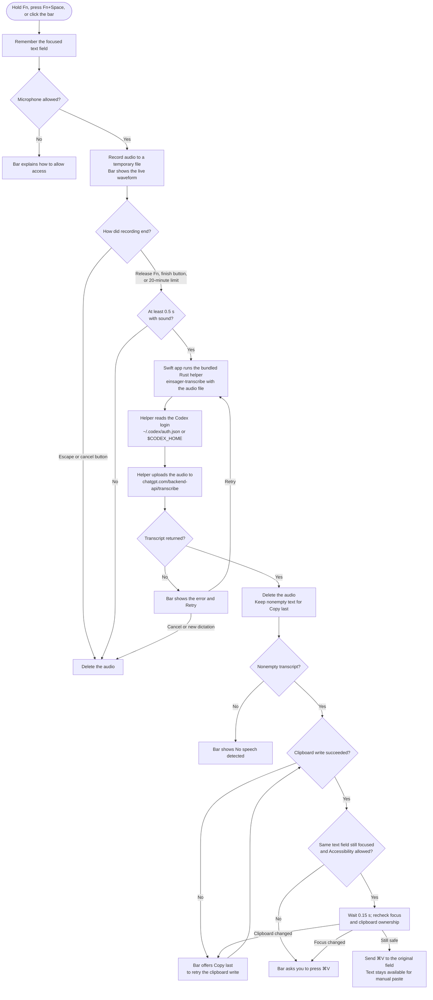

# einsager

einsager is an open-source dictation app with a native Mac version and a new
portable desktop layer for Linux, macOS, and Windows. It tries to make your existing
Codex login work as a Wispr Flow alternative on your own computer: hold a key,
speak, and the app sends a paste to the field you were typing in when focus is
still safe. You can also paste the transcript by hand.

It is an independent project. It is not affiliated with OpenAI or Wispr.

## How it works

The native Mac flow below remains available. The portable app uses Electron for
recording and the pill, then calls the same Rust helper. It copies the transcript
for manual paste. See [portable desktop setup and current limits](docs/cross-platform.md).

- A native Swift menu-bar app records your voice and shows a small floating bar
  with a live waveform.
- A bundled Rust helper sends the recording to ChatGPT for transcription. It
  uses the login that Codex stores in `~/.codex/auth.json` (or `$CODEX_HOME`).
- The app pastes the text into the field that had focus when you started. The
  text also stays on the clipboard, so you can paste it by hand if needed.



The app and the helper run on your computer, but transcription does not. Audio goes
to `chatgpt.com/backend-api/transcribe`. This is the internal endpoint that
Codex uses, not a public API, so it can change or stop working without notice.

## Requirements

- Portable desktop: Node.js 22.18+ and pnpm on Linux, macOS, or Windows
- Native Mac app: macOS with Xcode Command Line Tools
- Rust and Cargo
- A file-based Codex ChatGPT login on this computer (`codex login`)

## Build and install

For the new portable desktop layer (Node.js 22.18+, pnpm, Rust):

```sh
pnpm install --frozen-lockfile
pnpm build
pnpm start
```

Run `pnpm package` to bundle a runnable app for the current OS and architecture.
The first layer supports hands-free recording and clipboard recovery; global
Fn/hold-to-talk and automatic paste are still native Mac features. Portable WAV
recording is capped at 10 minutes; native Mac AAC recording retains 20 minutes.

To build and install the native Mac version:

```sh
zsh build.sh
ditto dist/einsager.app /Applications/einsager.app
open /Applications/einsager.app
```

On first use, macOS asks for Microphone access. To use Fn shortcuts and
automatic paste, also enable einsager under **System Settings → Privacy &
Security → Accessibility**.

## Use the native Mac app

| Action | Default |
|---|---|
| Hold to talk | Hold **Fn**, release to insert |
| Hands-free | **Fn+Space** or click the bar; finish with the check button |
| Lock hands-free | Double-tap **Fn** |
| Cancel | **Escape** or the cross button |
| Fallback hands-free | **Control+Option+Space** (works without Accessibility) |

Choose **Customize shortcuts…** from the menu-bar icon to change the keys.
Drag the bar to dock it at the bottom, top, left, or right of the screen. Recordings
stop at 20 minutes.

## Development

```sh
zsh scripts/check.sh
```

This runs Rust formatting, Clippy, and tests, the native logic checks, and the
floating bar renders. See [docs/proof-of-concept.md](docs/proof-of-concept.md)
for permission troubleshooting and the full verification history.

Use `pnpm check` for the portable app's types and unit tests, and
`pnpm test:desktop` after a desktop build for the fake-microphone smoke test.
That test uses an empty login folder and sends no transcription request.

## License

[MIT](LICENSE)
