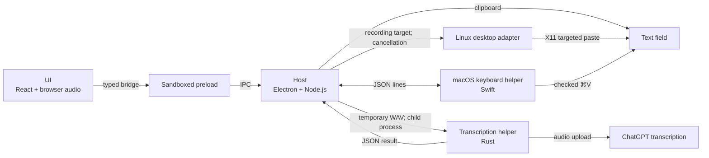

# Architecture

einsager is one Electron app with a Rust transcription helper. Start in
`apps/desktop/` for a UI or desktop change, or in `crates/transcription/` for a
login or upload change.

## Source map

| Directory | Language and runtime | Platforms | Owns |
|---|---|---|---|
| [`apps/desktop/src/main/`](../apps/desktop/src/main/) | TypeScript, Electron main process | All | Windows, tray, shortcuts, settings, history, clipboard delivery, trusted IPC, and the helper processes |
| [`apps/desktop/src/main/linux/`](../apps/desktop/src/main/linux/) | TypeScript, optional xdotool | Linux | X11/Wayland detection, focused window capture, targeted paste |
| [`apps/desktop/src/renderer/`](../apps/desktop/src/renderer/) | TypeScript, React, Chromium | All | Pill and tray panel UI, visible session, microphone capture, WAV encoding |
| [`apps/desktop/src/preload.ts`](../apps/desktop/src/preload.ts), [`panel-preload.ts`](../apps/desktop/src/panel-preload.ts) | TypeScript, sandboxed preloads | All | Narrow bridges from the pill and the tray panel to the main process |
| [`apps/desktop/src/shared/`](../apps/desktop/src/shared/) | TypeScript | All | Bridge contract, result types, and shortcut parsing; no privileged code |
| [`apps/desktop/native/macos/`](../apps/desktop/native/macos/) | Swift, Carbon event tap, Accessibility | macOS | Fn and custom shortcuts, and paste into the focused text field, in a child process |
| [`apps/desktop/scripts/`](../apps/desktop/scripts/) | Node.js, Swift | All | Build, package, and the macOS app icon |
| [`apps/desktop/tests/`](../apps/desktop/tests/) | Node test runner, Playwright | All | Unit tests and desktop smoke tests |
| [`crates/transcription/`](../crates/transcription/) | Rust executable | All | Codex login discovery, audio validation, ChatGPT upload, JSON output |
| [`assets/icons/`](../assets/icons/) | PDF, PNG | All | Vector logo for the macOS app icon, and the tray icon |

Root files hold dependency locks, compiler settings, CI, and the license.

## Process and data flow

The renderer owns audio capture and the visible session. It may use browser APIs
and shared types. It must not import `src/main/`, Electron, or Node.js. It runs
with sandboxing and context isolation, no Node access, and no external
navigation. Each preload exposes only the typed operations in
`src/shared/contract.ts`, not raw IPC. Main-process handlers check the sender
before they do privileged work. Main code does not import React or renderer
code. Paths in this section are relative to `apps/desktop/`.

`src/main/transcription.ts` owns one temporary WAV and one helper process.
Session generations reject results that arrive after a cancel or a newer
recording. The Rust helper reads credentials in its own process; no window
receives them. Its JSON output and WAV input are its contract with the host.

`src/main/delivery.ts` owns one recording's paste target, clipboard writes,
clipboard recovery, and cancellation. A paste target captures the focused window
or field when recording begins and sends the paste keys only if the same target
still has focus and the clipboard still holds the transcript. Two adapters
provide targets: `src/main/linux/desktop.ts` with xdotool on X11, and
`src/main/keyboard.ts` with the Swift helper on macOS. The helper compares the
frontmost app and its focused Accessibility element before it posts ⌘V. The
renderer never receives window IDs.

On macOS, Electron cannot see Fn or key releases. `native/macos/KeyboardHelper.swift`
runs the shortcut logic in `KeyboardShortcuts.swift` in an event tap and stores
custom shortcuts in its own `local.max.einsager.keys` defaults. It needs
Accessibility access; without it, the Electron fallback shortcut works and the
user pastes by hand.

## Find the behavior

| Change | Start here |
|---|---|
| Pill and visible session | `src/renderer/App.tsx` |
| Microphone and WAV encoding | `src/renderer/audio.ts` |
| Hold-key timing | `src/renderer/gesture.ts` |
| Windows, tray, settings, and IPC | `src/main/index.ts` |
| Tray panel: history, settings, session view | `src/renderer/Panel.tsx`, window in `src/main/panel.ts` |
| Transcript history and stored settings | `src/main/history.ts`, `src/main/settings.ts` |
| macOS shortcuts and paste | `native/macos/KeyboardHelper.swift`, `native/macos/KeyboardShortcuts.swift`, owner in `src/main/keyboard.ts` |
| Docking coordinates | `src/main/placement.ts` |
| Temporary audio, helper cancellation, Retry | `src/main/transcription.ts` |
| Clipboard modes, restore, paste targets | `src/main/delivery.ts` |
| OS differences | `src/main/platform.ts` |
| Linux capabilities and X11 paste | `src/main/linux/desktop.ts` |
| Packaging and the macOS icon | `scripts/package.mjs`, `scripts/make-app-icon.swift` |
| Login discovery, upload, CLI JSON | `crates/transcription/src/main.rs` |
| Release builds | `.github/workflows/release.yml` |

Add a new module when it can own a complete responsibility behind a smaller
interface. A new OS branch alone does not need a new module.

## OS differences

The host and the packager read `src/main/platform.ts`:

| Electron OS name | Paste hint | Helper filename | Keyboard helper | Template tray icon |
|---|---|---|---|---|
| `darwin` | `⌘V` | `einsager-transcribe` | `einsager-keys` | Yes |
| `linux` | `Ctrl+V` | `einsager-transcribe` | None | No |
| `win32` | `Ctrl+V` | `einsager-transcribe.exe` | None | No |

Electron provides the other window, clipboard, shortcut, and permission APIs.
The Linux adapter detects X11 or Wayland and optional `xdotool`; the host uses
its capabilities to turn off placement under Wayland. See [Linux](linux.md).

## Why Electron

Electron gives one recording and UI path on all three systems and reuses the
Rust helper. The cost is a larger download and more memory. Tauri would use less
memory, but it needs a separate webview and audio integration per system and
extra Linux build libraries.

## CPU architectures and build outputs

The source is the same for every CPU. Swift, Rust, and Electron build for the
host system and CPU. The scripts do not cross-compile or create universal
binaries, so build on each system and CPU you want to ship.

| Component | Command from the repository root | Output |
|---|---|---|
| Transcription helper | `cargo build --locked --release -j 1` | `target/release/einsager-transcribe` (`.exe` on Windows) |
| App and helpers | `pnpm build` | Helpers plus `apps/desktop/dist/` |
| Runnable app | `pnpm package` | `release/einsager-<Electron OS>-<CPU>/` |

Electron calls an Intel/AMD 64-bit CPU `x64` and Apple silicon `arm64`. The
release workflow builds Linux x64, macOS arm64, and Windows x64, because those
are the GitHub runner CPUs. See [Releasing](releasing.md).

On a Linux machine where a non-compiler command named `cc` comes first in
`PATH`, set `CARGO_TARGET_X86_64_UNKNOWN_LINUX_GNU_LINKER=/usr/bin/cc` and
`CC_x86_64_unknown_linux_gnu=/usr/bin/cc` for Cargo. `.cargo/config.toml`
already selects Apple's Clang on macOS.

## Checks

| Area | Command |
|---|---|
| Types and unit behavior | `pnpm check` |
| Rust helper | `cargo fmt --check`, `cargo test --locked -j 1`, `cargo clippy --locked -j 1 --all-targets -- -D warnings` |
| App from source | `pnpm test:desktop` after `pnpm build`; Linux uses `xvfb-run -a` |
| Packaged app | `pnpm test:packaged` after `pnpm package` |
| Linux paste and Wayland policy | `xvfb-run -a pnpm test:linux`, with xdotool installed |
| macOS shortcut logic | `pnpm test:macos` |
| macOS bundle signature | `codesign --verify --deep --strict release/einsager-darwin-*/einsager.app` |

CI runs all of these on Linux, macOS, and Windows in `.github/workflows/check.yml`.

Unit tests cover PCM/WAV output, the upload-size limit, docking and panel
placement, process cancellation, Retry with retained audio, each clipboard mode
and its restore guard, history storage and limits, settings validation, Linux
capability and focus cases, and the macOS paste protocol with a fake helper.
Rust tests use fixture credentials and a local test server.

The smoke tests use Chromium's fake microphone and an empty Codex folder, so they
send no transcription request. They drive recording, the missing-login error,
Retry, cancel, Copy, the tray panel and its settings, microphone choice, and side
docking, in both the source and the packaged app. The Linux test sends targeted
paste keys to a separate test editor, and a second run checks the Wayland policy
under Xvfb, which is not a real compositor. The test harness skips Chromium's
Linux sandbox check, so it does not catch a misconfigured `chrome-sandbox`.

Real microphones, Fn gestures, macOS paste, compositor behavior, and insertion in
daily-use apps need a person on the target system. Builds and automated tests do
not prove them.
