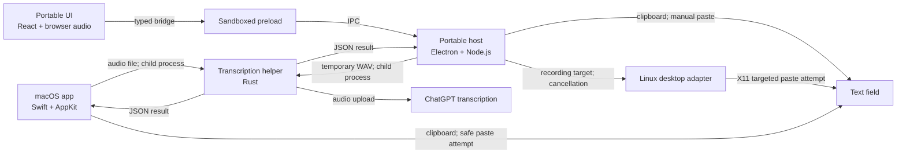

# Architecture

Einsager has two active apps and one shared transcription helper. Start with the
app directory for a UI change, or the Rust crate for a login or upload change.

## Source map

| Directory | Language and runtime | Platforms | Owns |
|---|---|---|---|
| [`apps/macos/src/`](../apps/macos/src/) | Swift, AppKit, AVFoundation, Carbon | macOS | Native UI, recording, Fn/hold shortcuts, focus checks, clipboard, and paste |
| [`apps/desktop/native/macos/`](../apps/desktop/native/macos/) | Swift, Carbon event tap, child process | macOS | Fn and custom shortcuts for the portable app, built from the native `KeyboardShortcuts.swift` |
| [`apps/desktop/src/main/`](../apps/desktop/src/main/) | TypeScript, Electron main process, Node.js | Linux, macOS, Windows | Window, tray, shortcuts, settings, clipboard delivery, trusted IPC, and helper process |
| [`apps/desktop/src/main/linux/`](../apps/desktop/src/main/linux/) | TypeScript, Node.js, optional xdotool | Linux | X11/Wayland detection, desktop capabilities, focused window capture, targeted paste |
| [`apps/desktop/src/renderer/`](../apps/desktop/src/renderer/) | TypeScript, React, Chromium browser APIs | Linux, macOS, Windows | Pill UI, visible session, microphone capture, and WAV encoding |
| [`apps/desktop/src/preload.ts`](../apps/desktop/src/preload.ts), [`panel-preload.ts`](../apps/desktop/src/panel-preload.ts) | TypeScript, sandboxed Electron preloads | Linux, macOS, Windows | Narrow bridges from the pill and the tray panel to the main process |
| [`apps/desktop/src/shared/contract.ts`](../apps/desktop/src/shared/contract.ts) | TypeScript types | Linux, macOS, Windows | Bridge operations, docking, and result types; no privileged runtime code |
| [`crates/transcription/`](../crates/transcription/) | Rust, native executable | Linux, macOS, Windows | Codex login discovery, audio validation, ChatGPT upload, and JSON output |
| [`assets/icons/`](../assets/icons/) | PDF and PNG | Both apps | Native PDF icon and portable PNG tray icon |

Each app keeps its tests and build scripts beside its source. The Rust crate
keeps unit tests beside its implementation and CLI tests in its own `tests/`.
Root Cargo and pnpm commands coordinate builds. Root configuration holds
dependency locks, compiler settings, CI, and the project license.

## Dependency and recording flow

The apps own recording and recovery. The helper does not import either app or
draw UI. It reads credentials inside its own process. Neither app's renderer
receives credentials. Native and portable session implementations are separate
because their recording, shortcut, and paste behavior differs.

Within the portable app, the renderer may use browser APIs and shared types.
It must not import `src/main/`, Electron, or Node.js. The preload exposes the
shared contract rather than raw IPC. Main-process handlers validate the sender
before running privileged work. Main code uses Electron/Node APIs and shared
types; it does not import React or renderer code. The packager also reads the
small OS policy module so it bundles the filename the host will launch.

## Find the behavior

| Change | Start here |
|---|---|
| Native Mac pill and docking | `apps/macos/src/DictationBar.swift` |
| Native Mac recording and app lifecycle | `apps/macos/src/Dictation.swift` |
| Native Mac session transitions and metering | `apps/macos/src/DictationSession.swift` |
| Native Mac focus, clipboard, and paste | `apps/macos/src/DictationDelivery.swift` |
| Native Mac key gestures and settings | `apps/macos/src/KeyboardShortcuts.swift` |
| Portable pill and visible session | `apps/desktop/src/renderer/App.tsx` |
| Portable microphone and WAV encoding | `apps/desktop/src/renderer/audio.ts` |
| Portable window, tray, settings, and IPC | `apps/desktop/src/main/index.ts` |
| Portable tray panel: history, settings, and session view | `apps/desktop/src/renderer/Panel.tsx`, window in `apps/desktop/src/main/panel.ts` |
| Portable transcript history and stored settings | `apps/desktop/src/main/history.ts`, `apps/desktop/src/main/settings.ts` |
| Portable macOS Fn and custom shortcuts | `apps/desktop/native/macos/KeyboardHelper.swift`, owner in `apps/desktop/src/main/keyboard.ts`, timing in `apps/desktop/src/renderer/gesture.ts` |
| Portable docking coordinates | `apps/desktop/src/main/placement.ts` |
| Portable temporary audio, helper cancellation, and Retry | `apps/desktop/src/main/transcription.ts` |
| Portable OS differences | `apps/desktop/src/main/platform.ts` |
| Linux capabilities and X11 paste | `apps/desktop/src/main/linux/desktop.ts` |
| Portable clipboard modes, restore, recovery, and target lifetime | `apps/desktop/src/main/delivery.ts` |
| Login discovery, audio formats, upload, and CLI JSON | `crates/transcription/src/main.rs` |

The current helper and desktop host are small enough to keep each related flow
in one module. Add a new module when it can own a complete responsibility with
a smaller caller interface. A new OS branch alone does not need a new app.

## OS differences

The portable host and packager use `src/main/platform.ts` for these differences:

| Electron OS name | User platform | Paste hint | Helper filename | Template tray icon |
|---|---|---|---|---|
| `darwin` | macOS | `⌘V` | `einsager-transcribe` | Yes |
| `linux` | Linux | `Ctrl+V` | `einsager-transcribe` | No |
| `win32` | Windows | `Ctrl+V` | `einsager-transcribe.exe` | No |

Electron provides the other portable window, clipboard, shortcut, and permission
APIs. Linux's desktop adapter detects X11 versus Wayland and optional `xdotool`;
the host uses its capabilities to disable compositor-controlled positioning.
TranscriptDelivery owns one recording's target, clipboard writes/recovery,
and cancellation guards; Linux owns the focus checks and keyboard commands.
The adapter never imports renderer or Electron code. See [Linux setup](linux.md).
The native app's Apple frameworks belong only in `apps/macos/`. The Rust
helper uses the OS home-directory API for login discovery. Only its Unix CLI
fallback test overrides `HOME`; Windows fallback tests use injected paths.

AppKit remains active during migration. The portable client supports hands-free
recording and clipboard recovery, plus X11 paste attempts on Linux and Fn
hold-to-talk on macOS. Its macOS keyboard helper compiles the native app's
`KeyboardShortcuts.swift`, so that file stays when the AppKit UI is removed.
Exact-field focus checks and the 20-minute AAC path remain native Mac features. See [portable limits](cross-platform.md).

## CPU architectures and build outputs

OS and CPU architecture are separate. The source is shared across CPUs; there
are no separate x64 and arm64 implementations. The Swift and Rust compilers
build for the host by default. Electron packages for `process.platform` and
`process.arch`. The current scripts build one host OS/CPU pair at a time and
expect a matching Rust helper. They do not create universal binaries or perform
cross-compilation. Build on each intended OS/CPU and verify that result there.

| Component | Command from the repository root | Output |
|---|---|---|
| Shared helper | `cargo build --locked --release -j 1` | `target/release/einsager-transcribe` (`.exe` on Windows) |
| Portable app and helper | `pnpm build` | Helper plus `apps/desktop/dist/` bundles |
| Portable runtime folder | `pnpm package` | `release/einsager-<Electron OS>-<CPU>/` |
| Native Mac app and helper | `zsh apps/macos/scripts/build.sh` | `dist/einsager.app` |

For example, Electron calls an Intel/AMD 64-bit CPU `x64` and an Apple Silicon
CPU `arm64`. A Rust target triple also names an OS and ABI, such as
`x86_64-unknown-linux-gnu` or `aarch64-apple-darwin`. The native Mac bundle contains
host-native executables even though its folder name has no CPU suffix.
Setting `CARGO_BUILD_TARGET` alone does not configure portable cross-packaging.
The three-OS CI matrix verifies its runner architectures, not every OS/CPU pair.

## Validation ownership

| Area | Checks |
|---|---|
| Shared Rust helper | `cargo fmt --check`, `cargo test --locked -j 1`, `cargo clippy --locked -j 1 --all-targets -- -D warnings` |
| Portable types and unit behavior | `pnpm check` |
| Portable development and packaged runtime | After build/package: `pnpm test:desktop` and `pnpm test:packaged`; Linux can use `xvfb-run -a` |
| Linux keyboard delivery and Wayland fallback policy | `xvfb-run -a pnpm test:linux`, with xdotool installed; a real compositor still needs acceptance |
| Native Mac logic, panel, and icon | `zsh apps/macos/scripts/check.sh` on macOS |
| Native Mac bundle | Build on macOS, then lint its plist and verify its code signature |

Smoke tests use a fake microphone and empty login folder. Rust protocol tests
use fixture credentials and a local test server. Live microphone permissions,
desktop compositor behavior, Fn gestures, and insertion require acceptance on
the target system. Build success and automated tests do not establish those.

On the coding VM, use the Build skill's resource guard for builds. Current CI,
review, and merge evidence belongs to the pull request; temporary reports and
renders belong in ignored `.agents/artifacts/`.
